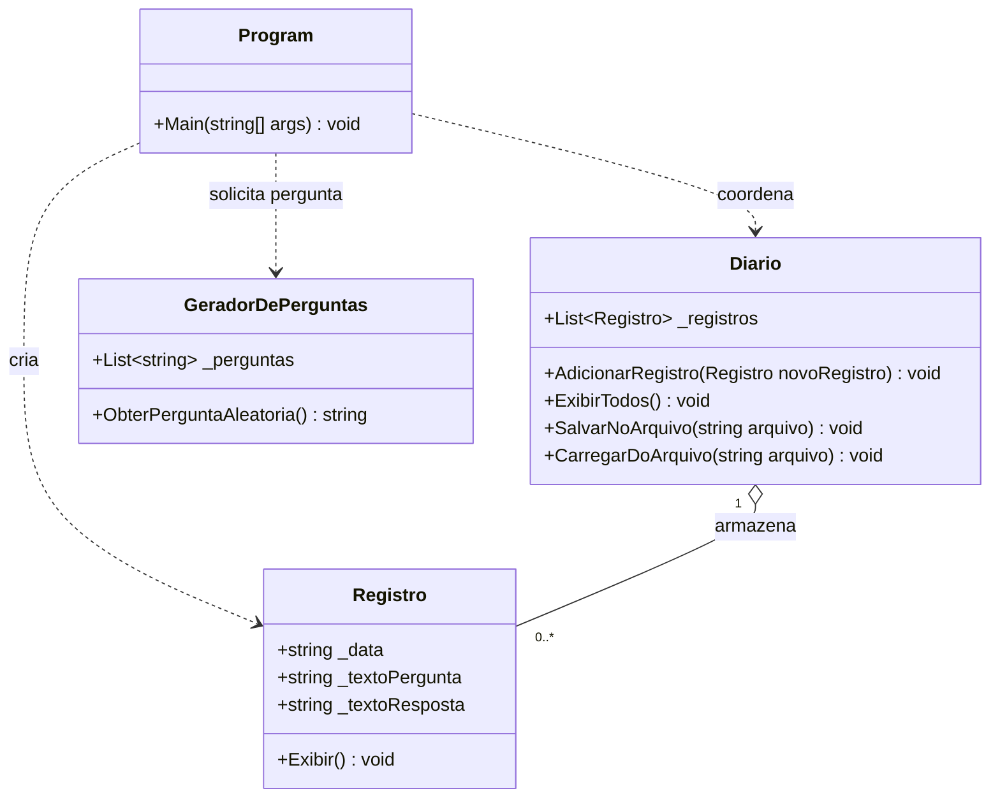

# S02 — Design do Programa de Diário

Autor: Gabriel Venditti Barreira

## Escopo desta atividade

Este documento prepara o design e os protótipos compiláveis solicitados na atividade de design de abstração. Os métodos ainda não implementam as funcionalidades do projeto completo. Não é um registro de reunião realizada nem comprovação de participação em grupo.

## Visão geral do programa planejado

O programa ajuda o usuário a manter um diário por meio de perguntas aleatórias. Cada registro reúne data, pergunta e resposta. Um menu permitirá escrever, exibir, salvar, carregar e sair.

| Opção planejada | Entrada | Comportamento e saída |
| --- | --- | --- |
| Escrever | Resposta à pergunta sorteada | Criar um registro com a data atual e adicioná-lo ao diário. |
| Exibir | Nenhuma entrada adicional | Mostrar data, pergunta e resposta de cada registro. |
| Salvar | Nome do arquivo | Gravar todos os registros do diário no arquivo indicado. |
| Carregar | Nome do arquivo | Ler o arquivo e substituir os registros atuais pelos registros carregados. |
| Sair | Escolha da opção de saída | Encerrar o laço do menu e terminar o programa. |

O gerador terá pelo menos cinco perguntas diferentes na implementação. A data será armazenada como `string`, conforme a simplificação permitida na especificação.

## Classes e responsabilidades

| Classe | Responsabilidade | Atributos | Métodos |
| --- | --- | --- | --- |
| `Diario` | Administrar a coleção de registros e sua persistência. | `_registros: List<Registro>` | `AdicionarRegistro(Registro): void`, `ExibirTodos(): void`, `SalvarNoArquivo(string): void`, `CarregarDoArquivo(string): void` |
| `Registro` | Representar e exibir uma anotação completa do diário. | `_data: string`, `_textoPergunta: string`, `_textoResposta: string` | `Exibir(): void` |
| `GeradorDePerguntas` | Fornecer uma pergunta aleatória, abstraindo a origem das perguntas. | `_perguntas: List<string>` | `ObterPerguntaAleatoria(): string` |
| `Program` | Coordenar o menu, ler as escolhas e chamar os objetos. | Variáveis locais para o diário, o gerador e a escolha do menu. | `Main(string[]): void` |

Cada classe fica em um arquivo com o mesmo nome. Os atributos públicos seguem o modelo introdutório da atividade; o objetivo desta etapa é praticar abstração. O acesso e as proteções dos atributos podem ser refinados ao estudar encapsulamento.

## Diagrama de classes



## Fluxo planejado para escrever um registro

1. `Program` solicita uma pergunta ao `GeradorDePerguntas`.
2. `Program` exibe a pergunta e lê a resposta do usuário.
3. `Program` cria um `Registro` e preenche sua data, pergunta e resposta.
4. `Program` chama `diario.AdicionarRegistro(novoRegistro)`.
5. Ao exibir o diário, `Diario.ExibirTodos()` percorre a coleção e chama `registro.Exibir()` em cada objeto.

## Decisões de design

- A leitura e a gravação de arquivos pertencem a `Diario`, pois tratam da coleção completa. Uma classe extra `Arquivo` não é necessária para este exercício.
- `Registro` controla sua própria apresentação. O diário precisa saber apenas que cada registro pode ser exibido.
- `GeradorDePerguntas` separa a obtenção de perguntas do menu. A fonte pode mudar sem alterar a assinatura de `ObterPerguntaAleatoria()`.
- `AdicionarRegistro` oferece uma operação de domínio em vez de expor ao código chamador os detalhes da coleção.
- Ao carregar, a implementação deverá substituir a coleção, conforme a especificação, em vez de anexar os dados ao diário atual. É recomendável concluir a leitura antes de trocar a coleção, para não perder os dados atuais se o arquivo não puder ser lido.

## Avalie o Design — apoio ao questionário

O questionário usa nomes diferentes para os mesmos conceitos: `Entrada` corresponde a `Registro`, e `GeradorDeComando` corresponde a `GeradorDePerguntas`.

### Pergunta 1 — Perguntas vindas de um banco de dados da Web

Alternativa: **“Uma. A classe GeradorDeComando.”**

A alteração deve ficar no gerador. O restante do programa continua solicitando uma pergunta e recebendo uma `string`, desde que a interface pública seja preservada. Isso demonstra como a abstração reduz a dependência dos detalhes de implementação.

### Pergunta 2 — Método Exibir na própria Entrada

Selecionar as alternativas:

- **“Se as variáveis de Entrada forem renomeadas, outras classes não precisam ser atualizadas.”**
- **“Se Entrada for alterada para conter outras informações, outras classes não precisam ser atualizadas.”**

Essas alternativas se referem ao código de exibição: `Diario` chama `Entrada.Exibir()` sem acessar diretamente seus campos para formatá-los. Assim, mudanças nessa apresentação ficam concentradas em `Entrada`. Código que acesse diretamente campos públicos, como a inicialização de um registro, ainda poderá exigir ajustes quando esses campos forem renomeados.

As opções sobre ter menos linhas ou menos métodos não são benefícios garantidos dessa separação. A vantagem principal é manter cada responsabilidade no lugar certo.

### Pergunta 3 — AdicionarEntrada em vez de acessar a lista

Alternativa: **“Se a maneira como as entradas são armazenadas mudar, o código que chama esse método não precisará mudar.”**

O chamador expressa a intenção de adicionar um registro. A classe `Diario` decide como fazer isso. Se a estrutura de armazenamento mudar, essa mudança poderá ficar dentro da classe, preservando a chamada ao método.

## Preparação para a reunião

- Confirmar horário, local e estudante líder com o grupo.
- Discutir as dificuldades na atividade de preparação e revisar a especificação.
- Comparar as responsabilidades, os métodos e os atributos deste design com as propostas do grupo.
- Registrar uma captura real da chamada com o título da atividade, seu nome e pelo menos outro participante.
- Definir o líder da próxima reunião.

O questionário deve ser respondido individualmente no Canvas. A captura de tela precisa ser obtida durante a reunião real; este documento não substitui essa etapa.

## Verificação dos protótipos

Os métodos `void` contêm somente comentários. O método que retorna `string` contém `return "";`, evitando erro de compilação nesta etapa. As listas são inicializadas, e os textos começam vazios.

Compilar a partir da raiz do repositório:

```sh
dotnet build semana02/Diario/Diario.csproj
```

## Referências

- [Atividade de Design de Abstração](https://byui-cse.github.io/cse210-ww-course-pt/week02/design.html)
- [Especificação do Programa de Diário](https://byui-cse.github.io/cse210-ww-course-pt/week02/develop.html)
- Questionário do Canvas fornecido pelo aluno em arquivo webarchive.
